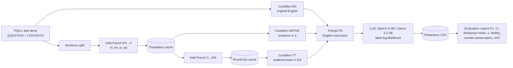

# P07 — Frozen Experiment Blueprint

Machine-readable version: `configs/protocol_v1.yaml`. Its SHA-256 at freeze time is recorded in `research_decisions.md` (D10).
No model outputs existed when this protocol was frozen. This document contains **no anticipated values**.

## 1. Inputs and outputs

- **Input item:** `(pmid, question, contexts[])` from PQA-L. Only `QUESTION` and `CONTEXTS` are used.
- **Output:** one label ∈ {yes, no, maybe}, saved per item with the log-likelihood of each label.
- **Saved predictions:** `results/preds/{model}/{condition}_{lang}_{template}.csv` with columns `pmid, gold, pred, ll_yes, ll_no, ll_maybe, n_input_tokens`.

## 2. Pipeline

The NATIVE condition simulates a paper written in language X, read directly. TT simulates the same paper machine-translated to English first. Because both start from the same EN→X text, the only difference between them is the X→EN step and the language the LLM reads.

## 3. Modules (Phase III build order, one at a time)

1. `src/data.py`: load, filter by split, build input; leakage assertion.
2. `src/translate.py`: sentence split; IndicTrans2 batching; cache keyed by (model, lang, segment hash); truncation counter.
3. `src/score.py`: chat template; label log-likelihood; label-token report.
4. `src/metrics.py`: macro-F1, accuracy, confusion matrix, κ, paired bootstrap, exact McNemar, Holm.
5. `src/rq3.py`: tokenizer fertility; number extraction with **native-digit normalisation** (Devanagari ०-९, Bengali ০-৯, Odia ୦-୯, Gurmukhi ੦-੯ → 0-9); round-trip chrF.
6. `scripts/`: `01_translate.py`, `02_score.py`, `03_evaluate.py`, `04_figures.py`.

## 4. Settings

| Setting | Value |
|---|---|
| Partitions | Test = official 500; dev = the other 500. No training. |
| Translation | Beam 5, max 512 new tokens, batch 32, fp16; translated once and cached |
| LLM inference | fp16, chat template, no sampling, label log-likelihood argmax |
| Prompt | P0 is primary; P1 and P2 are used only for sensitivity |
| Seeds | 2026 (torch, numpy, bootstrap). Scoring is deterministic apart from GPU floating-point effects, which are logged. |
| Budget | ≤ 12 T4 GPU-hours |

## 5. Metrics (direction)

| Metric | Direction | Used for |
|---|---|---|
| macro-F1 | ↑ | **Primary**, RQ1 |
| Accuracy, per-class F1 | ↑ | Secondary |
| Agreement with own English prediction; Cohen's κ | ↑ | RQ2 |
| EN-correct → X-wrong flip rate | ↓ | RQ2 |
| Token fertility (X tokens ÷ EN tokens, per model tokenizer) | ↓ = cheaper | RQ3 |
| Number-preservation rate (multiset share of source numbers found after translation) | ↑ | RQ3 / H3 |
| Round-trip chrF (TT evidence vs original EN) | ↑ | Translation-fidelity check |

## 6. Deeper analyses (at least one required; three planned)

1. **Error and failure analysis:** confusion matrices per condition; 20 sampled TT/NATIVE disagreements on Hindi read manually against the English original, with the error type coded (number changed, term mistranslated, negation lost, other).
2. **Efficiency:** token fertility and latency per language and model.
3. **Sensitivity:** whether the sign of Δ(TT − NATIVE) holds across prompt templates P0/P1/P2.

## 7. Expected outputs (formats only)

- **Table A:** macro-F1 / accuracy per model × {EN, NATIVE-X, TT-X} × language, with the Majority row.
- **Table B:** Δ(TT − NATIVE) with 95% CI, McNemar p (raw and Holm-adjusted), per language × model.
- **Table C:** agreement, κ and flip rate vs EN.
- **Figure 1:** forest plot of Δ with CIs, grouped by tier.
- **Figure 2:** fertility (x) vs NATIVE macro-F1 drop from EN (y), per language × model.
- **Figure 3:** number-preservation rate per language (EN→X and EN→X→EN).

## 8. Threats to validity

| Type | Threat | Mitigation or disclosure |
|---|---|---|
| Construct | "Native" inputs are machine-translated, not authored natively (the BenchMAX critique) | Stated as the main limitation; translation fidelity measured (RQ3, chrF) |
| Internal | TT uses the same MT family in both directions, so errors may correlate or cancel | Disclosed; round-trip chrF reported |
| Internal | Multi-token labels (e.g., "maybe") bias log-likelihood scoring | Label tokenization logged; label-prior shifts visible in confusion matrices |
| Internal | Prompt wording | Sensitivity analysis with P1/P2 |
| Internal | Pretraining contamination | Primary quantity is a paired difference; disclosed |
| Statistical | 55 "maybe" items make macro-F1 noisy; 8 comparisons | Bootstrap CIs; Holm correction; accuracy reported alongside |
| External | Two 3B models, one dataset, four languages | Claims limited to this setting |

## 9. Pre-experiment checklist (all ticked before the first TEST run)

- [ ] `protocol_v1.yaml` hash recorded (D10) and unchanged.
- [ ] P06 verification checklist complete.
- [ ] Leakage unit test passes on all 1,000 items.
- [ ] Translation cache complete for all 4 languages; truncation count logged; 5 samples per language eyeballed.
- [ ] G2: English dev macro-F1 > 23.71 for each primary model (`baseline_validation.md` B1).
- [ ] Evaluation code tested on synthetic predictions (all-yes reproduces 55.20/23.71 on test labels).
- [ ] No test-set predictions exist yet (`results/preds/` contains dev runs only).

## 10. Changing the protocol

A legitimate change, such as a broken model, a crash or a G2 gate failure, is handled as follows:
1. Copy to `protocol_v2.yaml`; edit there and never overwrite v1.
2. Add a `research_decisions.md` entry: what changed, why, **whether any test results had been seen**, and which conditions must be rerun.
3. Rerun **every** affected condition under v2; keep v1 outputs in `results/archive/`.
4. Report the change in the paper's Experimental Setup section.

A change made *because* a test result looked unfavourable is not legitimate. Such changes are reported as post-hoc, never as the primary result.
